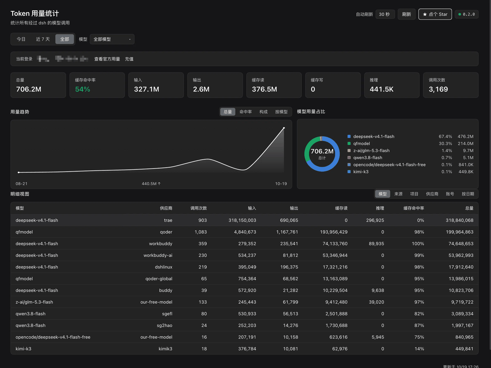

# dsh-token-metrics

[](https://github.com/deepseek-ai/deepseek-harness)
[](LICENSE)
[](package.json)

**中文** | [English](README.en.md)

一个 DSH 插件：把经过 DeepSeek Harness 的每一次模型调用都记下来，在侧边栏给你一个 Token 用量统计页。

装了它，你能看到如下指标：

- 今天、近 7 天与全部的 token 总量，以及趋势涨跌
- 各模型、各供应商的用量排行
- 缓存命中率——钱有没有花在重复输入上
- 各项目、各子代理的 token 消耗

数据来自 DSH 自己的会话日志，不额外发请求、不上传任何东西。

## 安装

在 DSH 里执行：

```
plugin_manager install_bundle /path/to/dsh-token-metrics
```

或手动加到 profile 的 `package.json`：

```json
{
  "dsh": { "profile": { "bundles": ["dsh-token-metrics"] } },
  "dependencies": { "dsh-token-metrics": "link:/path/to/dsh-token-metrics" }
}
```

重启 DSH，侧边栏就会出现「Token 用量统计」图标。装完第一次打开页面，插件会自动回扫历史会话日志，把以前的用量补上。

## 界面

侧边栏「Token 用量统计」页面：顶部是时间范围与模型筛选，中间是八项总计指标，
下方是趋势图与模型占比环形图，再往下是按模型 / 来源 / 项目 / 供应商 / 账号 / 日期
切换的明细表。



## 特性

- **总计**：input / output / cacheRead / cacheWrite / reasoning / total / 调用次数 / 缓存命中率
- **时间维度**：今日、近 7 天、全部
- **图表**：一张可切换的主趋势图，四种视角共用一张图
  （总量 / 命中率 / 输入构成 / **按模型**），平滑曲线 + 悬停显示具体数值
  + 一张模型用量占比环形图
- **模型筛选**：下拉多选，可单选/多选/取消，指标卡与趋势图同时刷新
- **模型合并**：占比图与趋势按**模型名**合并（跨供应商），明细表仍按供应商拆分
- **配色**：图表分类色自带亮/暗两套值，跟随主题切换
- **版本指示**：右上角版本号**本身就是按钮**，点击即检查更新，
  结果用弹窗告知（有新版可一键更新，无新版显示当前版本）
  状态灯：绿=最新 / 蓝=有新版本 / 灰=未检查
- **多语言**：跟随 DSH 的语言设置自适应（中文 / English），运行时切换即时生效
- **按来源**：主会话 / 子代理 / workflow
- **按项目**：按会话工作目录归组
- **按账号**：当前登录账号 + 余额 + 官方用量入口
- **明细表**：按标签切换模型 / 来源 / 项目 / 供应商 / 账号 / 日期等视图
  （会话明细默认隐藏，可配置打开）
- **失败请求**：次数，以及上游真计费时的 token
- **启动回扫**：首次安装即扫描已有会话日志补算历史，界面显示扫描进度
- **模型筛选下拉**：点击外部或按 Esc 自动收起
- **两个可视化卡片等高对齐**（趋势图与占比图上下边缘一致）
- **持久化**：重启不丢，跨会话累计
- **自更新**：检查新版本、安装、热重载，全程可回滚
- **零运行时依赖**：无构建步骤，不需要 npm install

## 配置

所有配置项都有默认值。要改的话，在你自己 profile 的 `cordis.patch.yml` 里加一条同 id 的 override：

```yaml
- id: token-metrics
  config:
    showSessions: true
    snapshotCacheMs: 5000
```

注意：同 id 的 override 会**整体替换** `config`，不是逐字段合并。改几项就把其余项一并写全，或者只写你要改的、其余依赖默认值。

| 配置项 | 默认值 | 范围 | 说明 |
| --- | --- | --- | --- |
| `flushDelayMs` | `2000` | 250–60000 | 落盘防抖（毫秒）。调用本身很轻，磁盘写入才是开销 |
| `snapshotCacheMs` | `3000` | 0–60000 | 聚合快照缓存时长（毫秒）。`0` 表示每次重算 |
| `retentionDays` | `400` | 0–3650 | 按天分桶保留天数。`0` 表示不裁剪 |
| `maxSessions` | `500` | 0–5000 | 统计页返回的会话明细上限 |
| `maxTrendSeries` | `6` | 1–20 | 趋势图最多画几条模型曲线，多出的聚合成「其他」 |
| `maxSeenEntries` | `200000` | 1000–2000000 | 去重表上限 |
| `showSessions` | `false` | — | 是否展示「按会话」明细 |
| `trackFailedAttempts` | `false` | — | 是否统计失败请求。详见「[失败请求](#失败请求)」 |
| `trackAccount` | `true` | — | 是否读取登录账号身份与余额（只读，不碰凭据） |
| `autoUpdate` | `true` | — | 是否启用自更新 |
| `watchFiles` | `false` | — | 监视包目录，改文件即热重载。开发用 |

## HTTP 接口

服务在宿主进程里，端口随 DSH。统计页顶部有对应按钮，也可以直接调：

| 方法 | 路径 | 作用 |
| --- | --- | --- |
| `GET` | `/api/dsh-token-metrics/summary` | 聚合快照，统计页的数据源 |
| `GET` | `/api/dsh-token-metrics/flush` | 立即落盘并返回最新快照 |
| `GET` | `/api/dsh-token-metrics/version` | 当前版本与更新状态 |
| `GET` | `/api/dsh-token-metrics/update/check` | 检查新版本 |
| `POST` | `/api/dsh-token-metrics/update/apply` | 安装新版本并热重载 |
| `POST` | `/api/dsh-token-metrics/reload` | 只热重载当前磁盘代码 |
| `POST` | `/api/dsh-token-metrics/rebuild` | 从会话日志重算全部统计 |

手动重算：

```bash
curl -X POST http://127.0.0.1:53414/api/dsh-token-metrics/rebuild
```

## 统计口径

数据来源是 DSH 的会话日志，这是唯一权威来源。每一次完成的模型调用都会在日志里
追加一条 `assistant/message` 事件，携带：

- `data.message.source.{provider, model}` —— 谁被调用了
- `data.usage` —— `inputTokens` / `outputTokens` / `totalTokens` /
  `cacheReadTokens` / `cacheWriteTokens` / `reasoningTokens`
- `data.turn` / `data.step` —— 天然的去重键
- `event.time` —— 按天分桶

因此统计覆盖：

| 场景 | 是否计入 | 原因 |
| --- | --- | --- |
| 主会话对话 | ✅ | 日志有 `assistant/message` |
| 子代理 / teammate | ✅ | 各有独立会话日志 |
| workflow 子会话 | ✅ | 同上 |
| 压缩（compaction） | ✅ | 由 `llm/stream` 补充捕获 |
| 会话标题生成 | ✅ | 由 `llm/stream` 补充捕获 |
| 失败的请求尝试 | ❌ | `assistant/attempt` 是重试中间态，计入会重复 |

## 多语言

界面文案通过宿主的 locale 服务注册，因此跟随 DSH 的语言设置（中文 / English），
**运行时切换即时生效**，不需要重开页面。

实现上有两个容易踩的坑，都已处理：

- `LocaleSnapshot` 的当前语言字段是 **`active`**（不是 `locale` 或 `id`）。
  早先读错字段名，导致语言永远退回默认值、完全不跟随设置。
- 只在注册时读一次语言也不够：面板需要订阅 `ctx.locale.subscribe`，否则
  语言切换后已经打开的页面不会重渲染。

## 模型口径：合并 vs 拆分

同一个模型可能挂在多个供应商下（例如 `deepseek-v4.1-flash` 同时出现在
trae / workbuddy / dshlinux / workbuddy-ai）。插件维护两套口径：

| 视图 | 口径 | 用途 |
| --- | --- | --- |
| `byModelName` / 占比图 / 趋势图 | **按模型名合并** | 同一模型的多条曲线合并成一条，否则图上会出现 4 条同名线、占比也被拆散 |
| `byModel` / 明细表 | **按供应商拆分** | 需要区分「哪个渠道花的钱」时看这里 |

两套口径的合计严格相等——它们只是对同一批事件的不同分组。

## 跨平台支持

插件不调用任何 shell / 系统命令，路径全部通过 `node:path` 拼接，
因此 **macOS、Windows、Linux 以及 Web 端 DSH 都可用**：

| 平台 | 支持 | 说明 |
| --- | --- | --- |
| macOS | ✅ | 开发与验证环境 |
| Windows | ✅ | 更新时 `rename` 带重试，见下 |
| Linux | ✅ | `fs.watch(recursive)` 需 Node ≥ 20，`engines` 已要求 ≥ 22.19 |
| Web 端 DSH | ✅ | 只依赖 Host 的 `webServer` 路由；没有它时其余功能仍工作 |

**Windows 专有处理**：运行中的 Node 会锁住模块文件，直接 `rename` 会抛
`EPERM`/`EACCES`（macOS/Linux 不会）。更新器用退避重试处理这类锁，
非可重试的错误照常抛出，不掩盖真实问题。

会话日志用 Node 内置 `zstdDecompressSync` 读取（跨平台一致的纯 JS/C++ 实现），
不依赖系统 `zstd` 命令。

## 「重载插件」按钮何时出现

它**默认不显示**，只在一种情况下出现：**磁盘上的代码已经换了，但运行中的
仍是旧版本**（`versionMismatch: true`）。

理由：更新流程本身包含热重载（下载 → 替换 → 自动 `selfReload`），所以平时
那个按钮是多余的。它真正的用途是**补救**——例如更新后激活失败、或你手动
改了磁盘上的 `index.js`，此时需要一次显式重载把新代码加载进来。

判据由 Host 的 `updater.status().versionMismatch` 提供：它比较「模块声明并
运行的版本」与「磁盘 `package.json` 的版本」，两者不同即为需要重载。

## 图表配色

图表分类色不用 `--dsw-alias-*` 语义 token：那些 token 表达的是**状态**
（成功/警告/错误），不是分类，而且深色主题里 `brand-primary` 会渲染成近白色，
画环形图会出现一条白弧。

因此分类色用插件自己声明的 `--tu-c1..7`，并在样式表里给出亮/暗两套值
（`[data-theme='dark']` 覆盖）。这样亮色模式是中等饱和度、暗色模式整体提亮，
相邻色始终可区分。

## 缓存命中率口径

```
命中率 = cacheReadTokens / (cacheReadTokens + inputTokens)
```

`inputTokens` 是真正新读入（未命中）的部分，`cacheReadTokens` 是命中缓存的部分，
两者相加才是这次调用消费的全部输入。`cacheWriteTokens` 是写入缓存的量，**不计入
分母**，否则会把命中率压低。

## 账号与用量归属

**历史数据无法回溯到账号。** 会话日志里 `assistant/message` 的结构化字段只有
`turn / step / message / usage / stream`，`message.source` 只有
`kind / provider / model / replayState`——没有 `accountId`、`userId`、`keyId`。
这是数据源的硬限制。

所以账号维度是这样工作的：

- 插件读取当前登录账号（`deepseekAccount.getProfile` / `getBalance`，**只读，
  不碰凭据**），显示在页面顶部，并给出官方用量页链接。
- 调用记录时带上「当时已知的账号」，因此**切换账号之后**的用量会归到新账号。
- 切换之前的历史统一归为「未知」。
- 官方账单口径以 `usageUrl` 指向的页面为准，本地统计用于趋势与归因。

不想让插件读取账号信息时，配置 `trackAccount: false` 关闭。

## 失败请求

`assistant/attempt` 是失败重试的中间态，理论上会消耗 token。但目前所有适配器
在这条路径上都只上报 `{0,0,0}` 的 usage——实测 259 次失败尝试、243 条 usage
记录，全部为零。

因此失败请求通常只有**次数**，没有 token 计入。插件保留了这条通道：如果上游
开始上报非零 usage，用量会自动出现在页面上，无需改代码。页面上会明确标注这个
限制，不会让你误以为失败请求不花钱。

该区块默认不显示，计数仍在内部累计。要看到它，把 `trackFailedAttempts`
设为 `true`：等上游开始上报真实用量后，数据会自动出现。

## 常见问题

**页面打开是空的？**
第一次打开要等回扫，几秒到十几秒，取决于会话数量。详见「[启动回扫](#启动回扫历史用量如何补齐)」。

**换账号后历史用量跑哪去了？**
归到「未知」。原因见上方「账号与用量归属」，日志里没有账号字段，补不回来。

**数字和官方账单对不上？**
本地统计按会话日志算，官方账单按实际计费算，两者口径不同。以官方为准，本地用来看趋势。

**更新失败怎么办？**
插件会明确报错并回滚。热重载依赖 Cordis 内部 API，DSH 或 Node 升级后可能失效，这时重启 DSH 即可。

**会拖慢 DSH 吗？**
不会。详见下方「性能」。

## 性能

统计分两条路径，开销差异很大：

| 路径 | 触发频率 | 实测开销 |
| --- | --- | --- |
| `record()` 记录一次调用 | 每个模型 step | **~0.9 µs** |
| 无关事件（tool/call 等） | 日志绝大多数 | **~0.02 µs** |
| `snapshot()` 命中缓存 | 每次页面轮询 | **~0.0002 µs** |
| `snapshot()` 冷计算 | 有新数据时首次 | ~3-5 ms |
| `flush()` 落盘 | 每 2 秒（防抖） | ~6 ms |

优化手段：

- **快照缓存**：聚合结果只在有新调用时才变，按 `snapshotCacheMs` 缓存后，
  轮询从 3ms 降到接近 0。
- **落盘防抖**：多次调用合并成一次磁盘写入。
- **prune 降频**：清理过期数据要遍历整张去重表，改为最多每分钟一次。
- **页面轮询可调**：10 秒 / 30 秒 / 1 分钟 / 5 分钟 / 关闭，选择记在
  localStorage；页面隐藏时自动停表。

所以「实时统计」的成本主要不在统计本身，而在磁盘与页面轮询——两者都已可控。

## 启动回扫：历史用量如何补齐

**首次安装即刻可用。** 插件启动时把已有会话日志全部扫描一遍，所以你安装后
立刻就能看到历史用量，而不是从零开始累计。

扫描进度会显示在页面上：一个旋转图标 + 「正在扫描历史会话」+ `已扫描 12 / 27`
的进度条。总数未知时进度条用循环动画表示「进行中」，不假装有确定的百分比。

三条扫描通路（任一条可用即完成扫描）：

1. `sessionPersistence` —— 通过宿主服务读取，最快；
2. 轮询同一个服务 —— 覆盖服务晚就绪的情况；
3. **磁盘直读** —— 直接解压 `.jsonl.zstd` 会话日志，不依赖任何 Host 服务，
   因此即使前两条都不可用，历史也一定能补回来。

扫描是增量的：每个会话记录已处理到的事件序号（`scanned[id].seq`），
之后启动只处理新增部分，不会重复全量扫描。

## 数据文件

```
$DSH_HOME/token-metrics/usage.json
```

**数据一致性存疑时绝不丢弃历史。** 早先的实现检测到 `calls` 与去重键数不符就
直接清零重建——而重建依赖 `sessionPersistence`，一旦该服务在某个组合里不可见，
历史数据就永久丢失。现在的行为是：

1. 标记 `needsRebuild`，**原样保留现有数据**；
2. 回扫成功后重建并清除标记；回扫失败则保留现有数据继续累计；
3. 回扫有三条通路，**其中一条直接从磁盘读取会话日志**（Node 内置
   `zstdDecompressSync` 解压 `.jsonl.zstd`），不依赖任何 Host 服务，因此
   历史数据总是能重建。

写入采用 1.5 秒防抖 + 临时文件原子替换，避免每次调用都碰磁盘、也避免进程中断
留下半截 JSON。文件损坏或版本不符时会重新初始化，不会让插件启动失败。

按天分桶保留 400 天；去重表最多保留 20 万条键。

## 实现要点

**两条数据通路，同一套去重键。**

主通路监听 `session/event`，捕获 `assistant/message` 与 `session/title`。
补充通路包裹 `llm/stream` waterfall，只处理不落日志的调用（压缩、标题生成、
无会话的直连调用），其余一律 `return next()` 原样透传。

两条通路都用 `(sessionId, turn, step)` 作为去重键，所以：

- 实时增量与启动回扫不会重复计数；
- 同一事件被投递多次也只算一次；
- 重启后从日志重扫是幂等的。

**回扫按 seq 增量。** `scanned[sessionId] = { revision, seq }`：revision 未变
直接跳过；变了则从已处理到的 seq 之后继续，不整段重扫。

**进程级单例。** 宿主热重载会加载第二份模块实例并各自 `apply()` 一次。若每个
实例各持一个 tracker，同一事件会被累加两次、两个实例又互相覆盖落盘结果。所以
tracker 挂在 `globalThis` 上，按 `buildId`（由 `index.js` 自身的大小与修改时间
派生）决定复用还是替换：

- 同一份代码 → 复用，不重复计数；
- 源码已变 → 换新实例并接管，修改立即生效。

**自检与自愈。** 正常情况下 `total.calls` 应严格等于去重键数（每次调用写一个
键）。接口返回 `integrity` 供页面判断；若读到偏差超过 10% 的历史文件，启动时
直接丢弃并按会话日志重建，而不是在错误数据上继续累加。

**退出落盘只装一次监听器。** 热重载会多次 `apply()`，每次都装
`beforeExit` 会累积监听器并拖住已废弃的 tracker；现在全局只装一个，并指向
当前 tracker。

## 跨版本升级

跨版本升级是**支持的**——只要两版文件布局兼容，直接替换即可，不需要先卸载。

但差异过大时直接覆盖有风险，因此升级前会评估跨度：

| 情况 | 处理 |
| --- | --- |
| 补丁 / 普通次版本升级 | 直接执行 |
| 跨主版本、或跨 ≥3 个次版本 | 标为 `risky`：仍可尝试，**失败时给出重装指引** |
| 目标包声明了 `dsh.minSupportedVersion` 且当前版本低于它 | 标为 `incompatible`：**直接拒绝，不动磁盘** |

`incompatible` 或 `risky` 失败时，页面会弹窗提示：

> 该版本与当前版本差异较大，自动升级未能完成。请先在插件管理里卸载本插件，
> 再重新安装最新版本；你的统计数据保存在 `$DSH_HOME/token-metrics` 下，
> 卸载不会丢失。

包作者可以在 `package.json` 里声明最低可升级版本：

```json
{ "dsh": { "minSupportedVersion": "0.2.0" } }
```

## 自更新与热重载

插件内置一条不依赖 pnpm 的更新通道，全自动，不需要手动重启：

```
检查新版本 → 下载 → 校验 → 备份 → 替换 → 热重载 → 失败回滚
```

- **更新源**固定取自 `package.json` 的 `repository`，**不接受任何来自配置或
  请求的 URL**——让配置项指向任意地址，就是从「写一个字段」直达「在宿主
  进程里执行任意代码」的一步之遥。
- 版本比对用真正的 semver 优先级（预发布排在正式版之前）。
- 下载的 tar 包在解压时做**路径穿越检查**，拒绝 `..` 与绝对路径。
- 替换前先备份整个包目录；**激活失败会把磁盘和运行时都回滚**，而不是留下
  一个半装状态。
- 热重载用 `expectedVersion` 校验替换上去的代码版本，确保跑起来的是新代码
  而不是缓存里的旧对象。

替换文件时先写临时名再 rename，避免半截文件被运行中的代码读到。Host 先回
`202`、再执行替换——热重载会注销当前 fiber，正在处理请求的 handler 会被
连带销毁。前端随后轮询版本号变化，确认升级真的生效，而不是凭「已受理」
就当成功。

热重载实测有效：改动 `index.js` 后触发 `/reload`，接口返回的 `buildId`
立即变为磁盘文件的新值（`<size>:<mtime>`），证明加载的是新代码。

统计页顶部有对应的按钮（检查更新 / 更新并重载 / 重载插件）。

### 关于热重载的边界

热重载依赖 Cordis 的内部 API（`loader.internal`、`registry`、`fiber`）。
这是在 DSH 没有「重载这个插件」官方 API 的情况下，唯一不受
`already-installed` 约束的路径。若某次 Node 版本升级改变了模块缓存的
形状，`reload` 会**明确失败并说明原因**，而不是悄悄留下旧代码；此时重启
DSH 即可。

## 开发

```bash
npm run check    # 语法 + 三套测试
npm test         # Host + Client + 更新器
npm run verify   # 与真实会话日志独立比对（需宿主在跑）
```

Host 测试用假 ctx 驱动 `apply()`，覆盖：事件签名、去重、历史回扫、跨重启幂等、
热重载单例、buildId 交接、去重表裁剪策略。Client 测试用假 ModuleLoader 与假
React 驱动 factory，覆盖：slot 注册、文案双语键一致、样式仅用主题 token。
更新器测试覆盖版本比较、repository 解析、tar 解压安全、备份回滚。

## 文件

| 文件 | 作用 |
| --- | --- |
| `index.js` | Host 侧：监听、聚合、回扫、账号快照、HTTP 接口 |
| `client.js` | Client 侧：侧边栏入口 + 统计页 |
| `src/updater.js` | 自更新：版本检查、下载校验、备份回滚 |
| `src/reload.js` | 热重载：模块缓存清理、fiber 替换 |
| `cordis.patch.yml` | Bundle patch，插入插件行 |
| `locale/{zh,en}.json` | Plugin Manager 里显示的标题与描述 |
| `icon.svg` | 插件图标 |
| `test/` | 测试：Host 集成、Client 冒烟、更新器、日志比对 |

## 贡献

欢迎提 Issue 和 PR，见 [CONTRIBUTING.md](CONTRIBUTING.md)。
参与本项目即表示同意 [行为准则](CODE_OF_CONDUCT.md)。安全问题的报告方式见 [SECURITY.md](SECURITY.md)。

如果这个插件对你有用，欢迎点个 Star ⭐——这是对开源作者最直接的支持。

## 许可

[MIT](LICENSE)

[](https://github.com/deepseek-ai/deepseek-harness)
