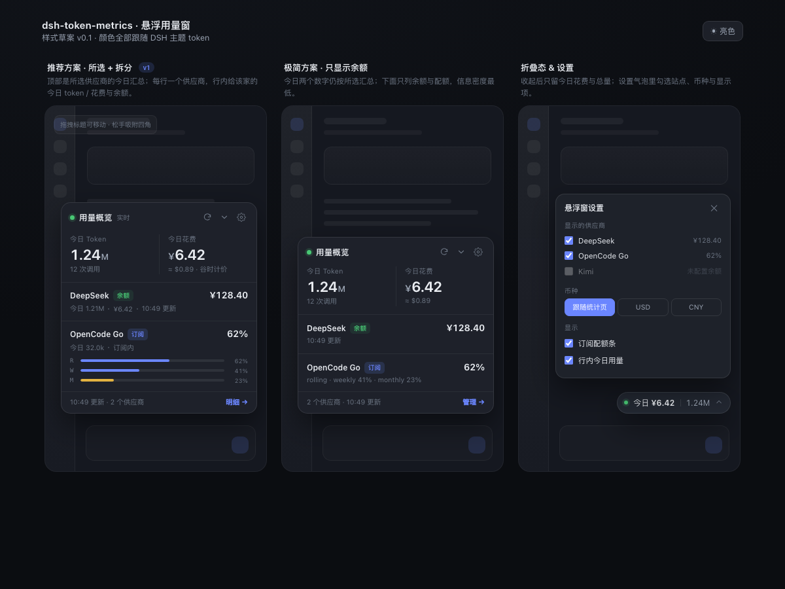
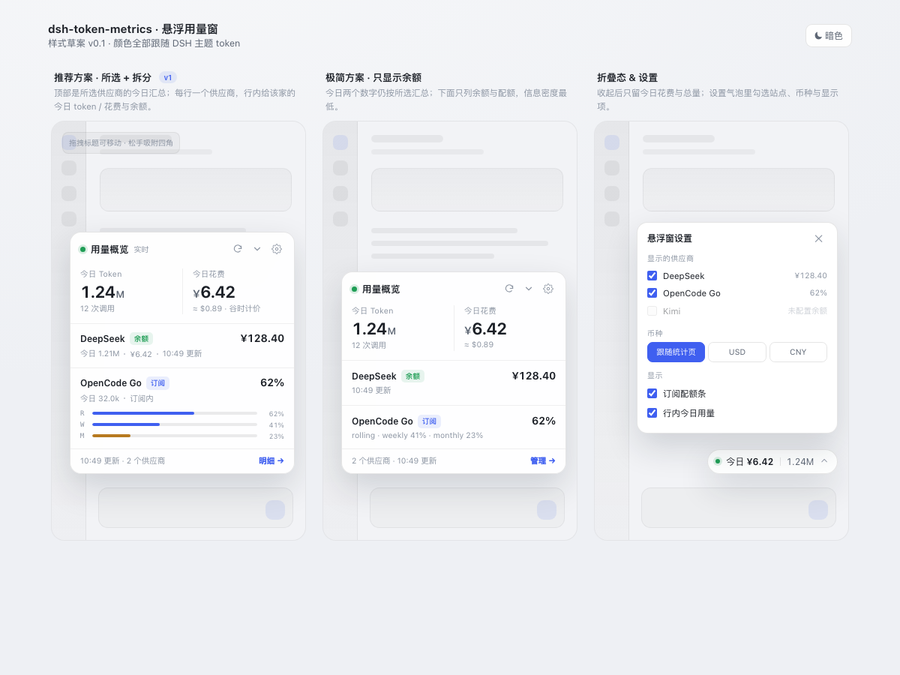

# 悬浮用量窗 · 设计与需求细化（v0.1 草案）

> 目标：不打开侧边栏统计页，也能在任意页面一眼看到「还能花多少、今天用了多少、今天花了多少」。
> 交互预览：`docs/floating-widget-preview.html`（浏览器直接打开，支持亮/暗切换）。预览是早期样式稿；最终位置策略见 §5：会话页右下、首屏右上、统计页自动隐藏。

---

## 1. 需求拆成三块

| 块 | 回答的问题 | 数据粒度 |
| --- | --- | --- |
| 余额 | 这个供应商还能用多少？ | 供应商 / 模型接入条目 |
| 今日 Token | 今天一共跑了多少？ | 全局，或按所选供应商拆 |
| 今日花费 | 今天大概花了多少钱？ | 全局，或按所选供应商拆 |

关键约束：**「余额」天然是供应商级，不是模型级**。同一家 DeepSeek 下的所有模型共用一个账户余额；OpenCode Go 是订阅制，没有余额，只有 rolling / weekly / monthly 三个配额窗口。因此悬浮窗的选择单位建议是「模型接入里的条目（站点）」，而不是单个模型名。若确实要按模型看用量，站点行下面再挂模型子行即可。

---

## 2. 数据可行性（现有 Host 快照）

| 需要的数据 | 现有字段 | 结论 |
| --- | --- | --- |
| 余额 / 配额 | `summary.balance.sites[].lastBalance`（`usd` / `raw` + `currency` / `quotas[]`） | 已有 |
| 今日 Token（全局） | `summary.totals.today.totalTokens`、`.calls` | 已有 |
| 今日花费（全局） | `summary.cost.byDay[summary.today]` + `summary.cost.fx.usdCny` | 已有 |
| 今日 Token（按供应商） | `summary.byDayModel[summary.today]` 的 `${provider}/${model}` 键 | 客户端可算 |
| 今日花费（按供应商 / 模型） | 目前只有 `cost.byModel` 全量值 | **需 Host 补一个 `cost.todayByModel`** |
| 站点 ↔ 用量 provider | `site.id` 同步进 DSH 后就是 provider 路由名；用量键前缀即 provider | 可直接匹配，另留别名兜底 |

Host 侧新增很小：在现有 cost 快照的按天循环里顺带累积 `todayByModel`（`${provider}/${model}` → `{ usd, priced }`），再加一个 `todayByProvider` 汇总即可，payload 只多几十行。

---

## 3. 统计口径（先定这个）

「其他的不要」有两种理解，直接决定顶部两个数字怎么算：

- **所选供应商**（推荐，默认）：今日 Token / 花费只累加勾选的站点，与下面的行严格对得上。勾了 DeepSeek + OpenCode Go，就只统计这两家。
- **全部**：今日两个数字是全局的，勾选只影响下面显示哪几家余额。好处是知道今天总共花了多少，代价是顶部和行内对不上。

建议做成设置项 `scope: "selected" | "all"`，默认 `selected`。下面三种方案都按 `selected` 画。

**已实现口径**：默认只统计勾选的供应商；订阅制站点（OpenCode Go / Kimi / GLM 等）的估算成本不计入「今日花费」，行内显示「订阅内」，避免把预付费当成今天又花了一笔。想按统计页的全量成本看，可在设置里切到「全部」。

---

## 4. 三种内容口径（需要选一个）





### 方案 A：今日汇总 + 选中站点余额

```
┌──────────────────────────────┐
│ ◉ 用量概览          ⟳  ⌄  ⚙ │
│                              │
│  今日 Token       今日花费    │
│  1.24M            ¥6.42      │
│  12 次调用        ≈ $0.89    │
│ ──────────────────────────── │
│ DeepSeek             ¥128.40 │
│ 余额 · 10:49 更新             │
│ ──────────────────────────── │
│ OpenCode Go             62%  │
│ 订阅 · rolling 62%            │
│ ▓▓▓▓▓▓▓░░░                   │
│ ──────────────────────────── │
│ 10:49 更新          明细 →    │
└──────────────────────────────┘
```

- 今日两个数字按 `scope` 计算，默认只算勾选的供应商，和行内数字对得上。
- 勾选只决定下面列哪几个供应商的余额。
- 改动最小，客户端就能上线。

### 方案 B：每个站点行内拆出今日用量

```
┌──────────────────────────────┐
│ ◉ 用量概览          ⟳  ⌄  ⚙ │
│ ──────────────────────────── │
│ DeepSeek             ¥128.40 │
│ 今日 32.1k · ¥0.42 · 余额     │
│ ──────────────────────────── │
│ OpenCode Go             62%  │
│ 今日 8.9k · 订阅内            │
│ ▓▓▓▓▓▓▓░░░  ▓▓▓▓░░░░░░       │
│ ──────────────────────────── │
│ 今日合计 41.0k tokens · ¥0.42 │
└──────────────────────────────┘
```

- 一眼看出「钱主要花在哪家」。
- 需要 Host 补 `cost.todayByModel`；订阅制站点的「花费」显示「订阅内」而不是 $0。
- 推荐作为 A 的增强项：顶部保留汇总，行内再给拆分，两者不冲突。

### 方案 C：按模型逐行

```
DeepSeek V4.1 Flash   ¥0.18   32.1k
DeepSeek V4.1 Pro     ¥0.24    8.2k
Claude Sonnet 4.5     订阅内    8.9k
```

- 最细，但余额字段会在每行重复，且需要维护「模型 → 站点」映射。
- 适合以后做「展开站点看模型」的二级视图，不建议作为首版主形态。

**建议：A + B 合体**——顶部汇总两个数字（默认只算所选供应商），下面每个站点一行，行内带该站点的今日 token / 花费。这样既满足原始三点需求，又能回答「哪家花得多」。

---

## 5. 形态与位置

### 形态

- **展开态**：卡片，宽 300px，最大高度 `min(420px, 60vh)`；超过 4 个站点时内部滚动。
- **折叠态**：胶囊，高 34px，显示 `今日 ¥6.42 · 1.24M`，点击展开；鼠标悬停 400ms 可临时展开。
- 不做「关闭即消失」：关闭 = 收起到侧边栏入口，否则用户找不到回来的路。恢复入口放在统计页右上角「悬浮窗」开关 + 侧边栏图标右键菜单。

### 位置（已实现）

- **会话页**：右下角，`bottom` 至少 96px，并按 `.tu-toasts` 的实时高度继续上移。测正文列 `[data-slot="conversation.chat.flow"]` 的父级右边缘；空隙不足时用 `translate: -Xpx 0` 把整列左移，列宽不变（长代码块不重新换行），右侧腾出 300px。
- **首屏 hero**：输入框贴着底部，右下角一定会压到它，所以这一屏自动停到右上角空白区（`top: 96px`）；进入会话后自动回右下角。
- **统计页**：本插件自己的统计页已经把这些数字全列出来了，悬浮窗在这一页自动隐藏，避免挡图表；离开后自动出现。
- **右栏打开时**：以 `[data-rightbar-col]` 的左边缘为右边界，停在右栏左侧，不盖右栏。
- 拖拽标题可移动；松手写入 `pinned: true`，之后不再自动避让；双击标题或设置里「重置位置」恢复自动。
- 窗口越窄，先缩卡片宽度（300 → 250），再不行才退化为覆盖模式（卡片边框变虚线）。

---

## 6. 交互

| 操作 | 行为 |
| --- | --- |
| 点站点头部 | 打开统计页「模型接入」页签并定位到该站点 |
| 点今日 Token / 花费 | 打开统计页「今日」 |
| 刷新按钮 | 重新拉 summary；余额单独走 `/balance/probe`，30s 内防抖 |
| 齿轮 | 打开设置气泡：勾选站点、币种、是否显示订阅配额条、透明度 |
| 折叠按钮 | 收成胶囊，状态记忆 |
| 拖拽 | 移动位置，四角吸附 |
| 键盘 | `Alt+T` 显示/隐藏；`Esc` 关设置气泡 |

自动刷新跟随统计页的设置（默认 30s），页面隐藏（`document.hidden`）时暂停；跨零点自动切到新的一天并刷新。

---

## 7. 设置项与持久化

存 localStorage：`dsh-token-metrics:widget`

```json
{
  "enabled": true,
  "collapsed": false,
  "corner": "bottom-right",
  "offset": { "x": 16, "y": 88 },
  "sites": ["deepseek", "opencode-go"],
  "scope": "selected",
  "mode": "split",
  "currency": "follow",
  "quotaBars": true,
  "opacity": 0.96
}
```

- `sites` 默认空：首次显示引导「选择要显示的供应商」，勾选后写入。
- `scope`：`selected` 只统计勾选站点（默认）；`all` 顶部统计全部、勾选只影响余额列表。
- `currency`：`follow` 跟随统计页的 USD/CNY 选择；也可强制 `usd` / `cny`。余额始终用站点原生币种（DeepSeek 可能是 CNY），不硬换算。
- 设置气泡里的站点列表直接来自 `summary.balance.sites`，没配置余额的站点灰显并提示「先去模型接入添加」。
- 同一份设置在「模型接入」卡片上也放一个「在悬浮窗显示」的勾选，双向同步。

---

## 8. 状态与边界

| 状态 | 展示 |
| --- | --- |
| 加载中 | 骨架条，不显示 0 |
| 未选站点 | 一行引导 + 「选择供应商」按钮 |
| 余额查询失败 | 保留上次值但置灰，标「查询失败」+ 重试图标 |
| 无订阅（`noPlan`） | 「未订阅」，不显示 0% |
| 订阅制有配额 | 只显示主窗口百分比 + 细条；hover 展开全部窗口 |
| 模型未定价 | 花费显示「—」，tooltip 说明「该模型未匹配价格」 |
| 离线 / summary 失败 | 显示 localStorage 里的上次快照，整体降透明度 + 「离线」 |
| 余额为 0 / 低于阈值 | 数字变 warn 色，不弹通知（通知仍由现有告警链路负责） |
| 跨零点 | 监听 `summary.today` 变化，重算今日值 |

安全：悬浮窗只读 summary 快照，不接触任何 API Key；余额探测仍走 Host 现有路由，密钥不出 Host。

---

## 9. 样式规范（跟随 DSH 主题 token）

| 项 | 值 |
| --- | --- |
| 容器 | `background: var(--dsw-alias-bg-overlay)`；`border: 1px solid var(--dsw-alias-border-l2)`；`border-radius: 14px`；`box-shadow: 0 16px 40px rgba(0,0,0,.22)`；`backdrop-filter: blur(14px)` |
| 标题 | 12.5px / 600 / `--dsw-alias-label-primary` |
| 次级文字 | 11.5px / `--dsw-alias-label-secondary` |
| 大数字 | 21px / 650 / `font-variant-numeric: tabular-nums` |
| 行高 | 站点行 44–52px，hover `--dsw-alias-interactive-bg-hover` |
| 品牌色 | 配额条 `--dsw-alias-brand-primary`；低余额 `--dsw-alias-state-warn-primary` |
| 圆角 | 容器 14、标签 999、进度条 999 |
| 动效 | 160ms ease；`prefers-reduced-motion` 下关闭 |
| 暗色 | 全靠 token，不写死颜色；亮色自动跟随 |

---

## 10. 实施拆分（已完成）

> 实现落点：`index.js` 的 cost 快照新增 `todayByModel` / `todayByProvider`；`client.js` 新增 `FloatingUsageWidget`、`shell.overlay` 注册与设置气泡；测试同步覆盖。

### 关键实现细节

- **provider 映射**：用量键是 `${provider}/${model}`，但 DSH provider 路由名不一定等于站点 id（实测 DeepSeek 的站点 id 是 `deepseek`，用量键是 `deepseek-account`）。按「全等 > 前缀」打分，每个 provider 只归一个站点，避免相似站点重复计数。
- **今日花费**：Host 在按天成本循环里顺手留下 `todayByModel`（含 `priced` 标记）与 `todayByProvider`，悬浮窗不按全量比例折算，峰谷价差不会被抹平。
- **位置轮询**：每 500ms 测一次布局（通知高度是动态的，没有可订阅的钩子）；不用 `requestAnimationFrame`，避免后台标签页节流导致布局变化后不再测量。
- **稳定性**：已挪过的位移会从「当前空隙」里扣掉再判断，并加回 `left gutter`，否则 500ms 一轮会来回抖动。


1. **Host（`index.js`）**：cost 快照增加 `todayByModel` 与 `todayByProvider`；`today` 日期字段已有，无需改。
2. **Client（`client.js`）**：
   - 新增 `FloatingWidget` 组件 + `WidgetSettings` 气泡；
   - `ctx.slots.inject('shell.overlay', ...)` 注册，id `token-metrics-widget`；
   - 样式追加到现有 `<style>` 块；
   - 拖拽 / 吸附 / localStorage / 可见性暂停 / 键盘快捷键。
3. **设置联动**：模型接入卡片增加「在悬浮窗显示」勾选。
4. **测试**：
   - `test/client-test.mjs` 断言注册了 `shell.overlay` 且渲染不抛错；
   - `test/host-test.mjs` 断言 `cost.todayByModel` 的键与金额；
   - 手工验收：亮/暗、窄窗、无站点、断网、跨零点、余额失败。

验收标准：打开任意页面能看到悬浮窗；勾选 DeepSeek 与 OpenCode Go 后只显示这两行；今日 token / 花费与统计页「今日」一致；余额查询失败不把数字清零；折叠后仍能看到今日花费。

---

## 11. 待确认

1. 今日用量/花费的统计口径：只算勾选的供应商（推荐，符合「其他的不要」），还是全局？
2. 悬浮窗默认位置：右下角避让通知，还是右上角？是否要拖拽吸附？
3. OpenCode Go 这类订阅制，显示三窗口迷你条，还是只显示主窗口百分比？
4. 首版默认显示哪些站点：手动勾选（推荐）、DeepSeek + OpenCode Go、还是全部已添加？

### 已确认的选择

- 统计口径：只算勾选的供应商 + 行内拆分。
- 形态：右下角、避让通知、可拖拽、可折叠；额外做「识别行宽，展开不覆盖内容」。
- 订阅配额：只显示主窗口百分比（当前为 5-hour 窗口），保留一条细进度条。

---

## 12. 实现注记（v0.3.9 之后）

### 刷新节奏

| 项 | 间隔 | 说明 |
| --- | --- | --- |
| 用量 / 花费数据 | 跟随统计页设置，默认 30s | 与统计页共用 localStorage 键 `dsh-token-metrics:refresh-ms`（0 = 只进入页面时读一次；10s / 30s / 60s / 5m）；`document.hidden` 时暂停 |
| 卡片几何测量 | 500ms | 无对应事件可订阅，只能轮询；数据刷新不触发重测 |
| 余额 | 仅手动点刷新 | 每站 30s 防抖，先把超期站点（最多 4 个）探一轮再拉 summary |

### 位置记忆与闪动

组件挂在 `overlay` 上，无驻留实例：页面刷新 / 从统计页切回都会重建。
重建后的第一帧若回落默认位置，等测量完成再跳过去，会被看成「闪动」。
所以最近一次算好的几何（right / bottom / width / overlap）写进
sessionStorage（键 `dsh-token-metrics:widget-geo`，10 分钟有效），
重建时第一帧直接落在原位。宿主布局变化后仍由 500ms 轮询校正，
记忆只负责「第一帧不闪」，不是权威位置。

### 升级回归检查（宿主选择器清单）

避让与隐藏依赖下列宿主内部约定，宿主升级改名后行为会**降级为覆盖模式
或常驻**，不会崩。dsh 升级后过一遍：

| 选择器 / 属性 | 用途 |
| --- | --- |
| `[data-slot="main"]` | 中央面板列；判定统计页是否激活（`.tu-root` 存在时悬浮窗隐藏），并作为退避测量锚点 |
| `[data-slot="conversation.chat.flow"]`（取其父级） | 限宽正文列，避让时整体 `translate` 左移的位移目标 |
| `[data-rightbar-col]` | 右栏开启时以其左边缘为右边界 |
| `data-phase="hero"` | 首屏 hero 停右上角 |
| `[data-shell-overlay]` | overlay 容器定位参考（`parentElement` 兜底） |

### 其它实现决定

- **打开统计页的页签请求**带写入时间戳，10 秒内面板挂载才算数；宿主没
  切成功时请求丢弃，不留过期指令。
- **拖拽**在标题栏上 `setPointerCapture`，拖出浏览器窗口松手也能正常收尾。
- **provider → 站点映射**内联在组件里，靠 host-test 的 `p/m` → `p` 与实测
  `deepseek-account` → `deepseek` 间接覆盖；若要单测可抽成纯函数。
- **订阅平台集合**（`WIDGET_QUOTA_PLATFORMS`）是 `src/providers.js`
  `HOST_PATTERNS` 的客户端兜底副本，新增平台时两处同步。
